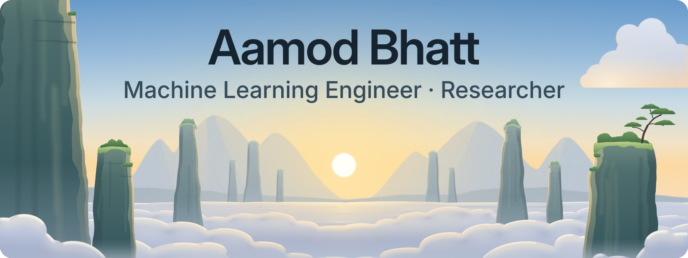
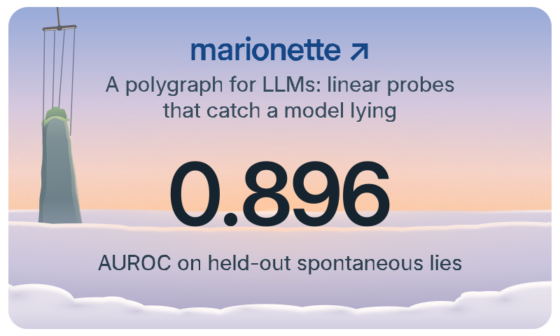
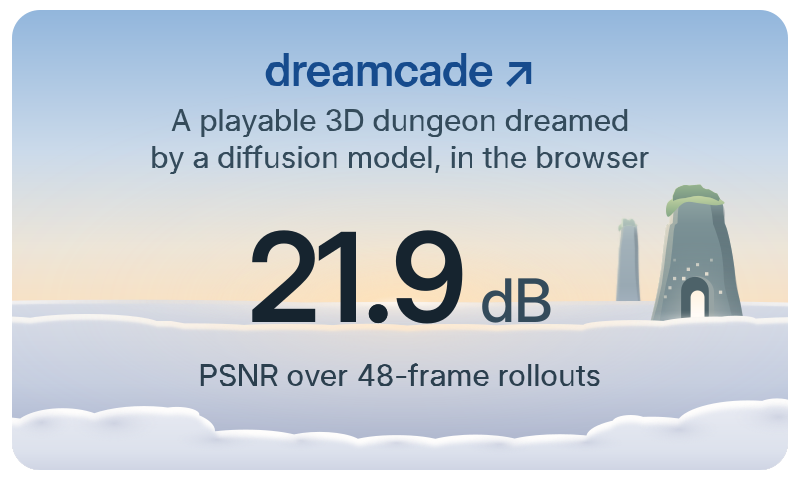
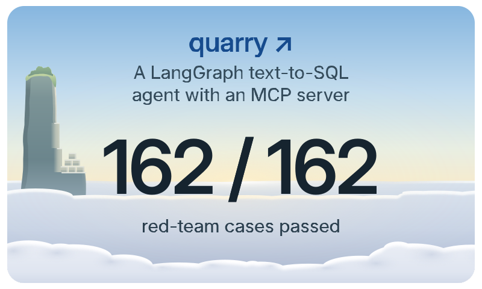
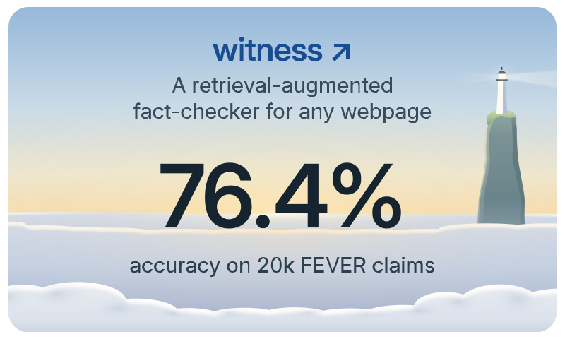
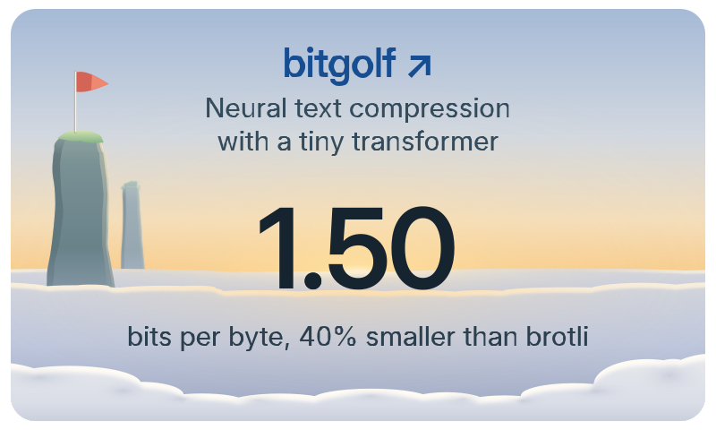
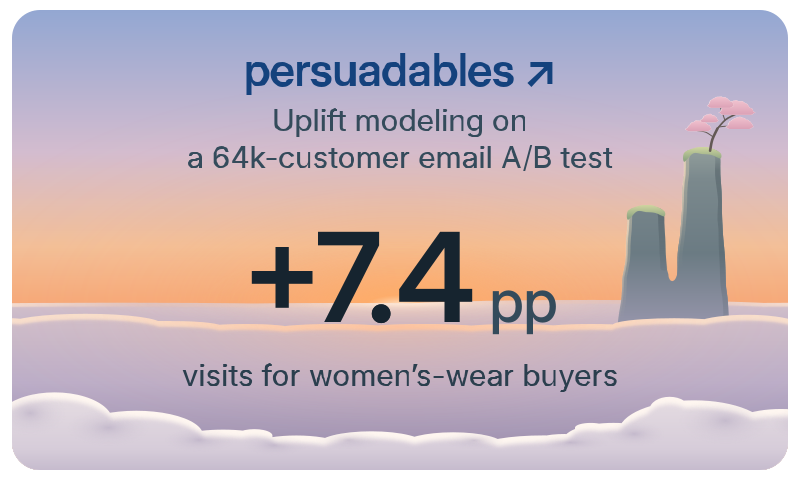
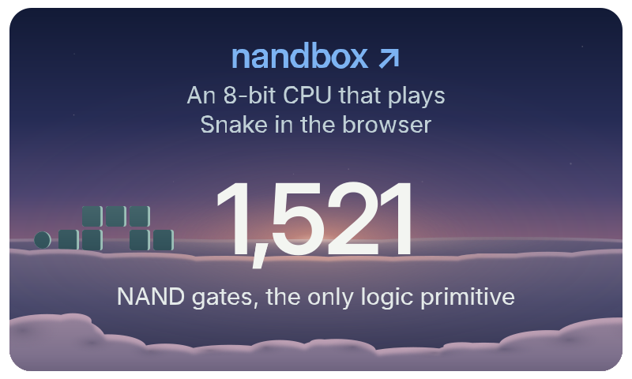
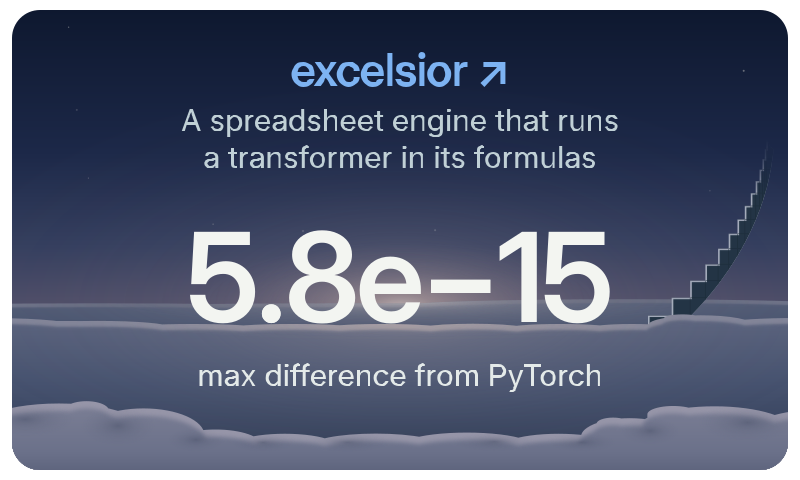
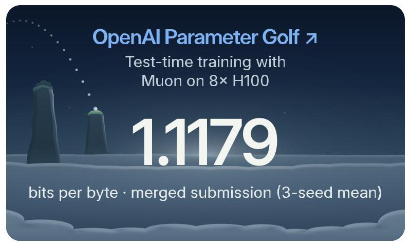

  <picture>
    <source media="(prefers-color-scheme: dark)" srcset="assets/hero-evening.svg">
    
  </picture>

Hi, I'm Aamod, a machine learning engineer. I build complete systems, from lie-detecting probes for LLMs to a dungeon you can play inside a diffusion model. Also a&nbsp;musician!

<a href="mailto:bhatt.aamod@gmail.com">bhatt.aamod@gmail.com</a>

 

### Selected work

### Research

### Toolkit

<picture><source media="(prefers-color-scheme: dark)" srcset="assets/toolkit/python-evening.svg"></picture>
<picture><source media="(prefers-color-scheme: dark)" srcset="assets/toolkit/pytorch-evening.svg"></picture>
<picture><source media="(prefers-color-scheme: dark)" srcset="assets/toolkit/transformers-evening.svg"></picture>
<picture><source media="(prefers-color-scheme: dark)" srcset="assets/toolkit/scikit-learn-evening.svg"></picture>
<picture><source media="(prefers-color-scheme: dark)" srcset="assets/toolkit/xgboost-evening.svg"></picture>
<picture><source media="(prefers-color-scheme: dark)" srcset="assets/toolkit/langgraph-evening.svg"></picture>
<picture><source media="(prefers-color-scheme: dark)" srcset="assets/toolkit/rag-evening.svg"></picture>
<picture><source media="(prefers-color-scheme: dark)" srcset="assets/toolkit/mcp-evening.svg"></picture>
<picture><source media="(prefers-color-scheme: dark)" srcset="assets/toolkit/lora-evening.svg"></picture>
<picture><source media="(prefers-color-scheme: dark)" srcset="assets/toolkit/sql-evening.svg"></picture>
<picture><source media="(prefers-color-scheme: dark)" srcset="assets/toolkit/duckdb-evening.svg"></picture>
<picture><source media="(prefers-color-scheme: dark)" srcset="assets/toolkit/fastapi-evening.svg"></picture>
<picture><source media="(prefers-color-scheme: dark)" srcset="assets/toolkit/docker-evening.svg"></picture>
<picture><source media="(prefers-color-scheme: dark)" srcset="assets/toolkit/aws-evening.svg"></picture>
<picture><source media="(prefers-color-scheme: dark)" srcset="assets/toolkit/typescript-evening.svg"></picture>
<picture><source media="(prefers-color-scheme: dark)" srcset="assets/toolkit/go-evening.svg"></picture>
<picture><source media="(prefers-color-scheme: dark)" srcset="assets/toolkit/rust-evening.svg"></picture>

Earlier work

 

- [lack-of-invariance](https://github.com/aamodbhatt/lack-of-invariance) · A study of how LLM answers shift when a question is&nbsp;paraphrased
- [model-arena](https://github.com/aamodbhatt/model-arena) · A terminal arena where specialized agents debate in structured&nbsp;rounds
- [recursive-knowledge-engine](https://github.com/aamodbhatt/recursive-knowledge-engine) · A RAG system that retrieves, answers, critiques and refines its own&nbsp;queries
- [ftuneprompt](https://github.com/aamodbhatt/ftuneprompt) · LoRA experiments on when to fine-tune and when to prompt, with a CLI that recommends&nbsp;one

